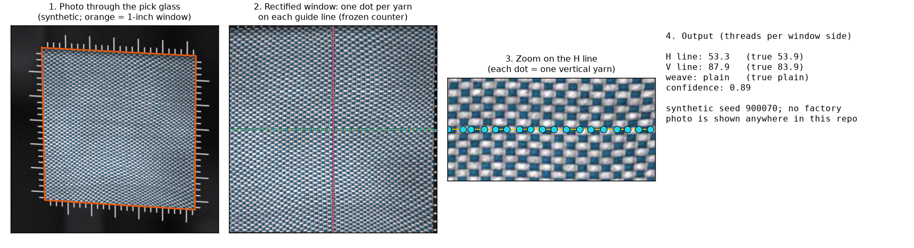

# PickGlass: counting threads per inch through a pick glass

Code, predictions and the annotation tool for **Image Quality and the Reliability of Fabric-Density Measurement: Counting Threads from Smartphone Photos Through a Pick Glass** (under review at the WACV 2027 workshop WVAQ, Image/Video/Audio Quality Assessment in Computer Vision, VLM and Diffusion Model).

A textile inspector checks thread density, the warp ends and weft picks per inch, by counting yarns through a 10x pick glass. We keep that tool and photograph the fabric **through** it with a phone: the glass's opening and engraved scales make every photo metric, and the problem becomes one of capture quality. This repository holds the task definition, a training-free reciprocal-lattice counter (PG-Lattice), a pre-registered combined counter (PG-Lattice + log-Gabor), the glass-ruler window detector, the capture-quality studies (degradations, phone-camera stress, generative enhancement, generic no-reference IQA), the VLM / CNN / CountGD baselines, a quality-aware cascade, a scene-aware annotation tool, and every prediction on PickGlass (150 files = 76 scenes) and on 13 hand-counted legacy crops.



*Every image in this repository is synthetic (`cnn/synth.py`) or a synthetic practice fabric. No factory photo is included; see [Data](#data).*

**Status (Oct 2026).**
- The counter, the scorer, the cascade decisions, the combined counter, the 76-scene generic-IQA test and the label-day analysis were frozen before any human count was looked at ([CHECKSUMS.md](CHECKSUMS.md)).
- The human counts of the 76 PickGlass scenes are made by two annotators, each counting every scene from scratch (label day Oct 12 2026); the reference is their mean. Both annotators counted all 76 scenes; the scored results are in the paper (under review).
- This release has the code, the frozen methods and protocols, and every machine prediction. The photos, crops, renders and both annotators' counts (with dot positions) will be added after the review period ([DATASHEET.md](DATASHEET.md)). The author took the photos with the mill's agreement.

## Contents

| Folder | What |
|---|---|
| `methods/` | PG-Lattice (`results/counting_frozen_final.py`, frozen; `counting.py`), the combined counter combined-v1 (`combined_v1.py`; rule `results/combined_frozen_v1.py` and `results/PREREG_combined_v1.json`, frozen), glass-ruler calibration (`ruler_calib.py`), degradations (`degrade.py`, `ablate.py`), the native-resolution guard (`guard/`), the faithful 2019 baseline (`legacy_2019/`), all results |
| `common/` | `rectify.py` (window -> S x S crop), `paths.py` (where data outside the repo is expected) |
| `annotation_tool/` | the browser tool (v2.2.2 with the completeness rule), scene propagation, analysis, tests, a synthetic demo set (`demo/`) and the job kit (`kit/`) |
| `cnn/` | synthetic fabric generator (`synth.py`), label-exact augmentation, training, scene-grouped CV, predictions (code and CSVs only, no weights) |
| `vlm/` | VLM prompts, OpenRouter client (key from the environment only), parsers, scaffolds, roster, raw answers and results |
| `camera_aug/` | PickGlass-Stress: phone-camera simulator, profiles, label audit, results |
| `genai_sr/` | pre-registered test of generative enhancement (protocol, server scripts, results) |
| `gpu_results/`, `ft_results/` | Molmo2-8B and CountGD on a GPU server; the synthetic-pointing LoRA for Molmo2-4B |
| `aug1016/` | label propagation to the 2024 notebook augmentations (CNN training) |
| `paper/` | `tools/` (the table and figure generators, scorer, label-day runner, generic-IQA analysis, re-shoot audit) and `tables/` (their outputs) |
| `data/` | manifest, scene map, window polygons, photo provenance, legacy hand counts, all predictions (no pixels) |
| `tools/` | `count_photos.py` (new photos -> counts), `verify_checksums.py`, `make_readme_figure.py` |
| `freelancer/` | only `same_patch_pairs.json` (label-free list of crops showing the same fabric patch) |
| `docs/` | [problem definition](docs/problem_definition.md), [annotation protocol](docs/annotation_protocol.md), [annotator guide](docs/annotator_guide.md), [counting guide](docs/counting_guide.md), [how to extend](docs/how_to_extend.md), [open problems](docs/open_problems.md) |

## Quickstart

```bash
git clone https://github.com/anoubhav/pickglass-thread-count && cd pickglass-thread-count
python3.11 -m venv .venv && . .venv/bin/activate && pip install -r requirements.txt

python3 tools/verify_checksums.py               # the frozen files are the published ones
python3 tools/make_readme_figure.py             # the figure above: the frozen counter on a synthetic fabric -> scratch/
python3 annotation_tool/server.py --demo --open # the annotation tool on three synthetic practice fabrics
python3 tools/count_photos.py my_photos/*.jpg --out counts.csv   # your own pick-glass photos (ruler -> crop -> counts)
cd paper && python3 tools/scenes76_labelfree.py # re-derive the label-free per-scene numbers from the released CSVs
```

Scoring human counts (after label day, or your own annotations of the same crops; with two annotators, pass both exports: the reference is their mean):

```bash
cd paper
python3 tools/score150.py --labels ../annotations_A1.csv --labels ../annotations_A2.csv --out ../scratch/tables \
  --fig --fig-dir ../scratch/tables --groups tables/fabric_groups_v2.csv \
  --extra-wide ../methods/results/combined_v1_150_wide.csv::combined-v1 \
  --extra-wide ../gpu_results/countgd/outputs/results/rect150_predictions_wide.csv::countgd,countgd@CG-W-ex3-lat \
  --extra-wide ../gpu_results/scored/molmo2_rect150_predictions_wide.csv::molmo2_8b_bf16,molmo2_8b_bf16@P4 \
  --extra-wide ../ft_results/results/rect150_predictions_wide.csv::molmo2_4b_synthft@P1,molmo2_4b_synthft@P4s \
  --extra-wide ../vlm/scaffold/results/rect150_S3_predictions_wide.csv::gpt-6.1-sol@S3,gemini-3.8-flash@S3,qwen3.8-27b@S3,s4-peaks \
  --extra-wide tables/src/extra150_wide.csv::pg-lattice@ruler,cascade-gate \
  --extra-wide ../cnn/runs_aug/report/real150_aug_wide_heldout.csv::cnn-aug-V4-b0,cnn-aug-V5-b0,cnn-aug-V2-r18
```

Always pass `--out`: the default overwrites `paper/tables/`.

## Reproduce the paper

Run `paper/tools/*` from `paper/`, everything else from the repository root. **Needs**: *repo* = runs from the files in this repository; *photos* = needs the 150 photos or the 13 legacy crops (to be added; `common/paths.py`); *sheet* = the 2019 hand-count sheet (`$PICKGLASS_LEGACY_ROOT/Warp-Weft count.xlsx`; the counts themselves are in `data/legacy13_hand_counts.csv`); *labels* = the PickGlass human counts (two annotators); *GPU* / *API* = a CUDA machine or `OPENROUTER_API_KEY`. Numbering follows the paper and supplement drafts of Oct 12 2026; check it against the published PDFs.

### Main paper

| Item | Content | Command | Needs |
|---|---|---|---|
| Fig. 1 | dataset photos + the task; panel (d) shows a factor-of-two disagreement on scene #45 | `python3 tools/make_fig_dataset_pipeline.py` (`--oct-labels <merged annotations>`) | photos, labels |
| Fig. 2 | factor-of-two (octave) errors against the human counts | `python3 tools/make_fig_octave.py` | labels |
| Fig. 3 | human dots vs the counter's crossings on two guide lines | `python3 tools/make_fig_overlay.py` | photos, labels |
| Fig. 4 | legacy degradation curves (all methods, byte-identical inputs) | `python3 tools/degradation_table.py` (inputs: `methods/degrade_vlmcrops.py`, `vlm/run_degrade_vlm.py`, `cnn/degrade_vlmcrops.py`) | repo (inputs: photos, API) |
| Tab. 1 | all methods (with combined-v1) and the human-vs-human row on PickGlass, per scene, against the mean of the two annotators | `python3 tools/score150.py --labels <A1.csv> --labels <A2.csv> ...` (above), or `tools/label_day.sh --real --protocol dual <exports>` (needs the LaTeX sources, see [paper/README.md](paper/README.md)) | labels |
| Legacy-13 table (supplement) | legacy-13, one crop rule | `python3 tools/legacy_unified.py` | sheet |
| Tab. 2 | capture-quality sensitivity (76 scenes; legacy column) | `python3 tools/scenes76_labelfree.py` + `python3 tools/degradation_table.py` (inputs: `methods/ablate.py --set all150 --degrade all`) | repo (inputs: photos) |
| Sec. 4 | combined counter combined-v1: thresholds fitted on synthetic data only, then the held-out synthetic test | `python3 methods/combined_v1.py --predict` (frozen rule on the frozen counter's outputs); `python3 methods/combined_v1_eval.py --synth` (fit and held-out renders: `methods/combined_v1.py --fit`, `--heldout-make`, `--heldout-score`) | repo (renders: minutes to hours of CPU) |

### Supplement

| Item | Content | Command | Needs |
|---|---|---|---|
| Fig. S1, Tab. S1 | legacy crop rule check; crop sensitivity | `python3 tables/src/make_crop_rule_check.py`; `python3 tools/make_supp_tables.py` | photos; repo |
| Fig. S2 | VLM error by model and prompt | `python3 vlm/make_summary_plot.py` (`vlm/evaluate_vlm.py` scores `vlm/raw/`) | repo |
| Tab. S2 | full legacy table | `python3 tools/legacy_unified.py` | sheet |
| Tab. S3 | window segmentation (2019 / 2024 / centred box) | `python3 methods/legacy_2019/repro_150.py`, `methods/legacy_2019/run_pipeline.py --out run1` | photos |
| Tab. S4 | label checks and agreement of the two annotators (screening answers, MAE, Bland-Altman, ICC(2,1), weave kappa, with and without a badge; post-hoc proposal check; sensitivity without #27/65/93/110; annotation time) | `tools/label_day.sh --real --protocol dual <exports>` (after label day) | labels |
| Figs. S3-S5 | lattice, failures, profile illustrations | `python3 tools/make_supp_figs.py` | photos |
| Figs. S6-S7 | Molmo2 pointing, CountGD | `python3 gpu_results/make_paper_figs.py` (runs: `gpu_results/code/`, `gpu_results/countgd/code/`) | photos (runs: GPU) |
| Figs. S8-S10 | degradation examples; drift; confidence vs drift | `python3 methods/make_figs.py all` (inputs: `methods/ablate.py`) | photos for S8; repo for S9-S10 |
| Tab. S5 | legacy degradation table | `python3 tools/make_supp_tables.py` | repo |
| Tab. S6 | which quality signal predicts counting error: generic no-reference IQA (BRISQUE, NIQE, MUSIQ, CLIP-IQA, TOPIQ-NR) vs the counter's confidence, the resolvability and the gate | `python3 tools/iqa_generic.py` (per-image scores: `python3 tools/iqa_scores.py`, pyiqa); the pre-specified 76-scene test `python3 tools/iqa150.py --labels ...` | repo (scores: photos + pyiqa; 76-scene test: labels) |
| Fig. S11, Tab. S7 | coverage curve; error by flag and stratum | `python3 tools/score150.py --labels ... --fig`; `python3 tools/quality150.py --labels ...` | labels |
| Tab. S8 | standards and tolerances | hand-written ([docs/problem_definition.md](docs/problem_definition.md)) | - |
| Tab. S9 | tolerance-referenced legacy metrics (post hoc) | `python3 tools/tolerance_legacy13.py` | repo |
| Fig. S12, Tab. S10, Fig. S13 | ruler detection; ruler accuracy; glass constants | `python3 tools/make_ruler_fig.py` (writes both figures); `python3 methods/ruler_eval.py calib` (and `count`, `perturb`, `photodeg`, `blur`) then `python3 methods/ruler_summary.py` | photos for S12 and `ruler_eval`; repo for the summary (+ scikit-learn) and S13 |
| Tab. S11, Figs. S14-S15 | measurement scaffolds for VLMs | `python3 vlm/make_scaffold_figs.py` (runs: `vlm/run_scaffolds.py`, `vlm/evaluate_scaffolds.py`) | photos (the script draws S14 from legacy crop a2 before the table and S15; runs: API) |
| Fig. S16, Tab. S12 | synthetic-pointing LoRA | `python3 ft_results/code/make_figs_ft.py`; `python3 ft_results/code/make_ft_tables.py` (training: `ft_results/code/train_lora.py`) | photos; repo (training: GPU) |
| Tab. S13, Fig. S17 | quality-aware cascade | `python3 tools/cascade_tradeoff.py --eval` (never `--fit`; it rewrites the frozen `tables/cascade_150_decisions.csv` byte-identically, check with `tools/verify_checksums.py`; inputs `methods/cascade_synth.py`) | repo |
| Fig. S18, Tab. S14, Fig. S19 | dataset; file kinds per scene and re-shoots of one fabric patch; pipeline strip | `python3 tools/make_dataset_fig.py --rows raw,quarter`; `python3 tools/scenes76_labelfree.py` and `python3 tools/fabric_groups_v2.py` (re-shoot audit -> `tables/fabric_groups_v2.csv`); `python3 tools/make_fig_pipeline.py --variant strip` | photos; repo (re-shoot audit: photos); photos |
| Tab. S15 | px per yarn vs count change | `python3 camera_aug/label_audit.py summarise` (from `results/label_audit_*.csv`) | repo (sweep: photos) |
| Tab. S16, Fig. S20 | PickGlass-Stress on legacy-13; camera profiles | `python3 camera_aug/score_stress.py` then `python3 tools/make_camera_stress_supp.py`; `python3 camera_aug/make_camera_fig.py` (renders: `camera_aug/build_stress.py`) | repo; photos |
| Tab. S17, Fig. S21 | generative enhancement | `python3 genai_sr/make_paper_table.py` (after `genai_sr/analyze.py`); `python3 genai_sr/make_figure.py` (restorers: `genai_sr/server/`) | repo; photos (restorers: GPU, API) |
| Tab. S18 | native-resolution guard | `python3 methods/guard/analyze_real.py`, `python3 methods/guard/posthoc_supplement.py --tables` (tuning: `methods/guard/tune_synth.py`, synthetic only) | repo |
| Figs. S22-S23 | minimum resolution; CNN augmentation on legacy-13 | `python3 cnn/augment_optics_verify.py`; `python3 cnn/score_aug.py` (training: `cnn/train_aug.py`, `cnn/train_cv.py`) | photos for the S22 sweep; sheet for S23 (training: GPU) |

Predictions (one command each, all frozen in this repository): PG-Lattice `python3 methods/run_ours_150.py`, legacy `python3 methods/run_legacy_vlmcrops.py`; VLMs `python3 vlm/run_vlm.py` / `vlm/openrouter_client.py`; CNN `python3 cnn/evaluate.py`; ruler `python3 methods/ruler_eval.py calib`; combined-v1 `python3 methods/combined_v1.py --predict`; extra wide files `python3 tools/make_extra150_wide.py`. Re-running them overwrites the frozen predictions: do it in a branch.

## Tests

Without the photos: `node annotation_tool/tests/test_core.js` (38 of 39 pass; the manifest check that every crop file exists needs the photo release), `node annotation_tool/tests/test_scenes.js` (11), `node annotation_tool/tests/test_attention.js` (9), `python3 annotation_tool/tests/test_scenes.py` (7), `python3 annotation_tool/tests/test_attention.py` (8). `annotation_tool/tests/test_examples.*` and `aug1016/tests/test_propagate.py` need the photo release (the Examples panel and the notebook augmentations). [SCAN_REPORT.md](SCAN_REPORT.md) lists the tables that were regenerated byte-identically from this repository before release.

## Data

`data/` holds everything that has no pixels: `manifest.json` (150 files, window polygons, scene fields, machine proposals), `scene_map.csv`, `window_polygons.csv`, `photo_provenance.json` (sizes and MD5 of the photos), `legacy13_hand_counts.csv` and `predictions/` (every method on PickGlass and legacy-13, with `INDEX.csv`). See [data/README.md](data/README.md).

**The photos, rectified crops, the 13 legacy crops, degraded copies, PickGlass-Stress renders, generative-enhancement outputs and the human counts with dot positions will be added after the review period**, on an archive with a DOI ([DATASHEET.md](DATASHEET.md), [DATA_LICENSE](DATA_LICENSE)). The code expects them where `common/paths.py` says (environment variables with repo-relative defaults): `PICKGLASS_NOTEBOOKS` (photos and polygons), `PICKGLASS_LEGACY_ROOT` (2019 material), `PICKGLASS_SCRATCH`, `PICKGLASS_GPU_HOST`, `PICKGLASS_REMOTE_ROOT`, `OPENROUTER_API_KEY`. Run `python3 common/paths.py` to see what is found.

## Freeze and checksums

`CHECKSUMS.md` lists the SHA-256 (and the MD5 disclosed in the paper) of the frozen counter, the scorer, the frozen cascade decisions, the combined counter and its pre-registration, the 76-scene generic-IQA test, the label-day analysis (`paper/tools/label_day.py`) and the other pre-registration records; `SHA256SUMS` covers every file except itself, `EXPORT_PROVENANCE.json` and `SCAN_REPORT.md`; `python3 tools/verify_checksums.py` checks both. The section *Commitments* of `CHECKSUMS.md` lists every file a pre-registration record commits to by SHA-256, including the few that carry per-scene human counts and will be added with both annotators' counts. The ensembles and the learned octave selector cannot be re-run from this repository until then (they read those files); their frozen predictions are here.

## Documentation

- [Problem definition](docs/problem_definition.md): task, measurand, metrics, protocol, leakage rules.
- [Annotation protocol](docs/annotation_protocol.md): the tool, the completeness rule, the screening test and pass rule, the two-annotator protocol (each annotator counts every scene from scratch; agreement; the reference is their mean), how to recruit and screen annotators.
- [Annotator guide](docs/annotator_guide.md) and [counting guide](docs/counting_guide.md) (synthetic pictures only).
- [How to extend](docs/how_to_extend.md): new photos -> window polygon or ruler -> rectify -> annotate -> propagate -> score.
- [Open problems](docs/open_problems.md): glass calibration, the human noise floor beyond two annotators, more mills / glasses / phones, defocus, a multi-window protocol.
- [MODEL_CARD.md](MODEL_CARD.md) (screening, not certification), [DATASHEET.md](DATASHEET.md), [THIRD_PARTY.md](THIRD_PARTY.md).

## Citation

```bibtex
@inproceedings{pickglass2027,
  title     = {Image Quality and the Reliability of Fabric-Density Measurement: Counting Threads from Smartphone Photos Through a Pick Glass},
  author    = {Agarwaal, Anoubhav},
  booktitle = {WACV 2027 Workshop on Image/Video/Audio Quality Assessment in Computer Vision, VLM and Diffusion Model (WVAQ)},
  year      = {2027},
  note      = {Under review. TODO: pages, DOI}
}
```

## Licence

Code and documentation: MIT ([LICENSE](LICENSE)). Data: to be announced ([DATA_LICENSE](DATA_LICENSE) defines which files are data).

## Acknowledgements

The 2019 baseline, the 13 legacy crops and their hand counts come from the 2019 Textile Quality Analysis project of the Computer Vision and Intelligence club, IIT Madras; `methods/legacy_2019/` is a line-by-line re-implementation of its counting step. TODO (author): names of the 2019 team members who agree to be credited.
