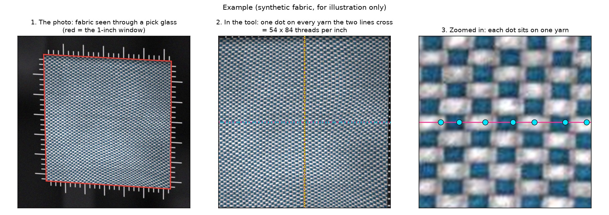
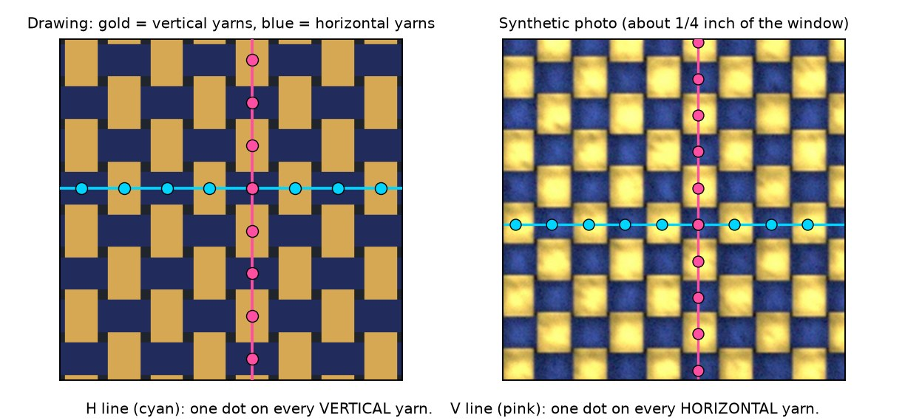
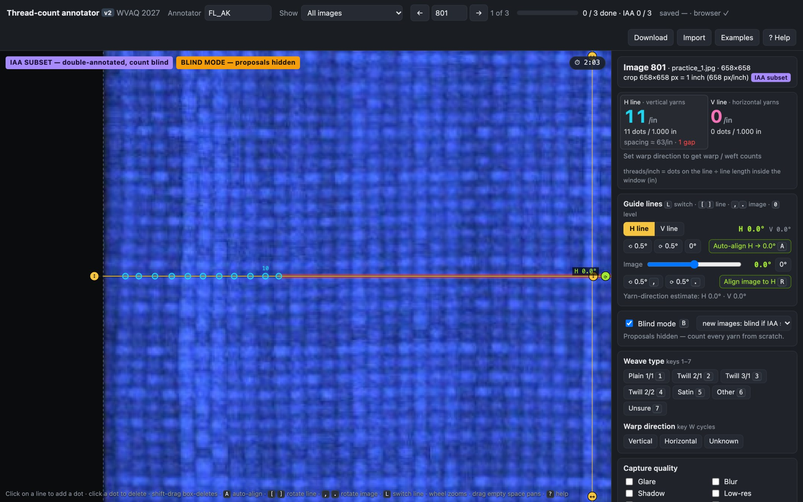
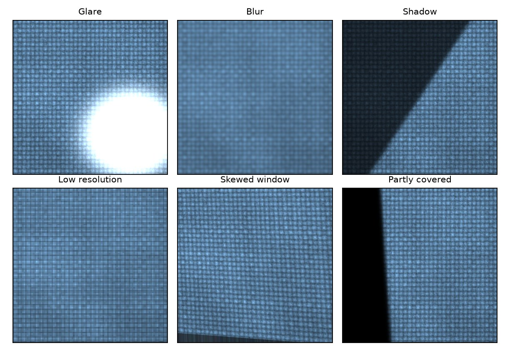
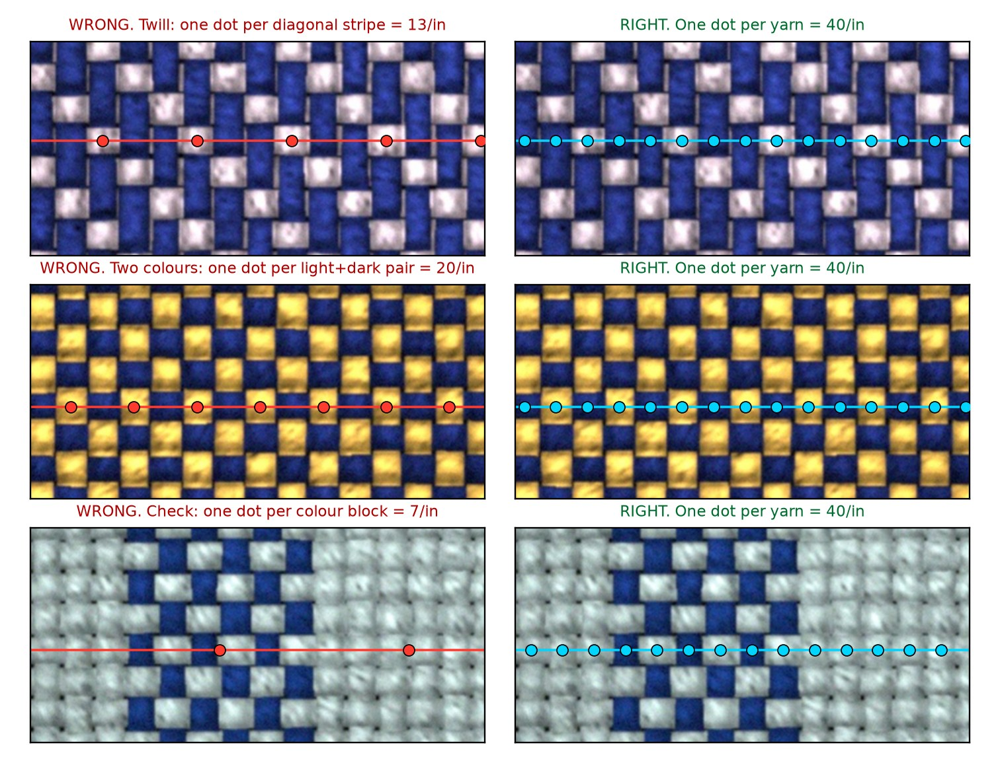
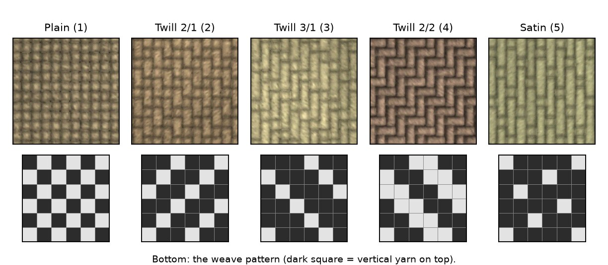

# Thread-count annotation guide

*Release edition.* This is the full guide that comes with the annotation tool, edited for publication: every figure is a **synthetic** fabric (`cnn/synth.py`; sources in `img/guide/SOURCES.json`), the hiring-platform details are removed, and the order of work describes the protocol actually run for PickGlass (two annotators, each counting every photo from scratch, no machine dots). The edition sent with the job on Oct 9 2026 described an earlier plan (a blind 20-photo subset counted by two people first, machine starting dots on the other photos) and illustrated it with machine dots on four real photos, the guide examples (scenes #27, #65, #93, #110); see [annotation_protocol.md](annotation_protocol.md).

**The job:** count the threads per inch on magnified fabric photos (pick-glass photos), in both directions, with a small browser tool. For 76 photos allow **about 2 to 4 hours** in total. Please read this guide once before you start; it takes about 15 minutes.

Each photo shows exactly **one square inch** of fabric (the pick-glass window). It is already cut out and straightened, so you never mark corners. Two guide lines cross the photo: a horizontal line (**H**) and a vertical line (**V**). You put **one dot on every yarn each line crosses**. The number of dots on a line is the threads per inch in that direction, and the tool shows it as the big number.

## 1. Open the tool

1. Open the link you received in **Google Chrome** or **Microsoft Edge** on a laptop or desktop computer, not on a phone or tablet. Use a mouse with a scroll wheel. Nothing needs to be installed. (To try it locally: `python3 annotation_tool/server.py --demo --open`.)
2. In the **Annotator** box at the top, type the code you were given. Use **exactly the same code every time**: your work is saved under it.
3. Your work is saved automatically **in this browser on this computer**. Always use the same computer and the same browser. Never use a private or incognito window, and do not clear your browsing data until you have delivered your work.
4. At the end of **every** session, click **Download** (top right). The browser saves two files, a `.json` and a `.csv`. Keep them: they are your backup.

Your answers stay in your browser until you download them and send them; the tool does not upload anything.

## 2. Order of work

The tool may hold more files than photos to count: some files are copies of the same photo at another resolution or turned by 90 degrees, and the tool copies your counts to them automatically.

| Step | What | How |
| --- | --- | --- |
| 1 | **Count every photo from scratch** | Set **Show -> Scenes to annotate** and press **N** to jump to the next unfinished photo. No photo has starting dots: you place every dot yourself. |
| 2 | **Deliver** | When the progress bar shows all photos done, click **Download** and send both files (see *Delivering your work*). |

Please send a first **Download** after your first 10 photos, so that we can confirm early that everything works.

## 3. What you mark on every photo

| # | What | How | Keys |
| --- | --- | --- | --- |
| 1 | **H line** (horizontal) | Exactly one dot on every yarn the H line crosses (these are the vertical yarns). | click on the line = add a dot, click a dot = delete it, Shift-drag = delete many |
| 2 | **V line** (vertical) | The same for the yarns the V line crosses (the horizontal yarns). | L switches between the lines |
| 3 | **Weave type** | Plain, twill 2/1, 3/1, 2/2, satin or other. Pick **Unsure** rather than guess. | 1 to 7 |
| 4 | **Warp direction** | Click **Unknown** unless you really know it. | W cycles |
| 5 | **Photo problems** | Tick every problem you see: glare, blur, shadow, low-res, perspective, partially occluded. Tick **Not a woven fabric** for knits or felt. | click the boxes |
| 6 | **Confidence** | 3 = sure, 2 = mostly sure, 1 = rough estimate. Then press **Enter** to save and go to the next photo. | C cycles, then Enter |

**The tool accepts a photo as done only when it is complete:** a weave and a confidence are set, and each line has at least 10 dots that reach from one end of the line to the other (at least 75 % of it) with no large gap (red bar). If part of the window really is covered, tick *Partially occluded* or write why in Notes: that waives the reach and gap checks, but every counted line still needs at least 10 dots. A line may stay empty only with a reason in Notes and confidence 1.

## 4. How to count a line

Put exactly one dot on every yarn the guide line crosses, from one edge of the window to the other.

*The H line (cyan) gets a dot on every vertical yarn, the V line (pink) a dot on every horizontal yarn.*

1. **Zoom in** with the mouse wheel until neighbouring yarns are at least a finger-width apart on screen. Pan with space-drag, or drag an empty area. Work from the left (or top) end of the line to the other end.
2. **Check every dot.** Click a dot to delete an extra one, and click on the line to add a missing one. A **red bar** marks a gap (a missed yarn?), and an **orange bar** marks two dots that are too close (a duplicate?). Look there first. **Z** undoes.
3. **Edges:** count a yarn at the edge of the window only if its centre is inside the window.
4. **Quick sanity check:** count the yarns in one tenth of an inch and multiply by 10. If that is far from the big number, something is off.
5. **The line can go anywhere.** Drag its round handle to move it to a clearer row; the count is the same anywhere in the window.
6. **Tilted yarns:** if the yarns do not cross the line at right angles, press **A** to turn the selected line across its yarns, or press **R** to turn the image instead (**,** and **.** turn the image by hand, **/** turns it back). The tool corrects the number for the tilt automatically. Under about 10 degrees of tilt you can leave the line straight.

The big number under **H line** and **V line** is threads per inch. For a straight (level) line it equals the number of dots.

## 5. Bad photos: what to do

**Never skip a photo just because it is imperfect.** The difficult photos matter as much as the easy ones. Count what you can see, tick the problem and lower the confidence.

| Problem you see | What to do | Tick | Confidence |
| --- | --- | --- | --- |
| **Glare** (white shiny patch) | Drag the line to a row without glare. If the glare covers the whole line, count through it where the yarns show. | Glare | 3 if the moved line is clear, else 2 |
| **Blur** (soft yarns) | Zoom in. If you can still tell the yarns apart, count normally. | Blur | 2 |
| **Dark or shadowed** | Press **E** for the brighter, high-contrast view, or move the line out of the shadow. | Shadow | 2 to 3 |
| **Yarns tilted** against the lines | Press **A** (turn the line) or **R** (turn the image), check that the line now crosses the yarns at right angles, then count. | Perspective (only if the window itself looks skewed) | unchanged |
| **Low resolution** (yarns 2 to 3 pixels wide) | Zoom in and count anyway. | Low-res | 1 to 2 |
| **Part of the window covered** (finger, edge of the glass) | Move the line to the uncovered part. | Partially occluded | 2 |
| **Yarns impossible to see** on one line, on every row | Press **Clear H dots** or **Clear V dots** for that line (leave it empty) and say why in **Notes**. Do not guess a number. | the cause | 1 |
| **Not woven** (knit, felt, lace) | Tick **Not a woven fabric** and leave both lines empty. | Not a woven fabric | not needed |

## 6. Tricky fabrics

The rule never changes: **one dot per individual yarn** crossing the line. Patterns and colours only make the yarns harder to see.

| Fabric | The trap | What to count |
| --- | --- | --- |
| **Two-colour plain weave** | Light and dark squares look like one unit | A light float and the dark float beside it are **two** yarns |
| **Twill** (diagonal stripes) | Counting the diagonal stripes | Each stripe spans several yarns, so your dots sit **closer together** than the stripes |
| **Herringbone** | The diagonals change direction | As for twill: ignore the zig-zag and count yarns |
| **Satin** (smooth, shiny) | Long floats hide the yarns underneath | Count the yarns you can separate; if you truly cannot, use confidence 1 |
| **Checks, plaid, houndstooth** | A colour block looks like one yarn | Colour blocks are groups of yarns: dot every yarn and ignore colour changes |
| **Very dense** (more than about 120 per inch) | Losing your place | Zoom further, work one tenth of an inch at a time, and run the x10 sanity check |

## 7. When you are unsure

The counts matter most. Spend your time there, and answer these three quickly.

- **Weave type (keys 1 to 7):** a checkerboard of single floats is plain (1). Diagonal lines mean twill: count how many yarns one float passes over. 2 is twill 2/1 (2), 3 is twill 3/1 (3), and an even 2-up-2-down is twill 2/2 (4). A smooth surface with long floats and no clear diagonal is satin (5). Anything else is other (6). If you are not sure after a few seconds, pick **Unsure (7)**: a wrong guess hurts the data more than Unsure.
- **Warp direction (W):** the photo rarely shows which way the fabric came off the loom, so **Unknown** is the normal answer. Pick vertical or horizontal only if you know it, for example from the selvedge.
- **Confidence (C):** 3 means you would bet on the count to within a thread or two. 2 means it could be off by a few. 1 means a rough estimate from a hard photo.

## 8. Badges you may see

- **Orange *Check carefully: ...* or yellow *Take care: ...*:** automatic checks found this photo hard (for example, different computer programs disagree, or the yarns are very fine). The badge never tells you the count. Count every yarn as usual, just more carefully.
- **Teal, *same scene as #..., labels copied*:** a copy of another photo. You do not annotate it. Press **G** to open the photo to annotate. In **Show -> Scenes to annotate** you never see copies.
- **Purple, *IAA subset* / *BLIND MODE*:** the photo opens with no starting dots and you place every dot yourself. In the practice set every photo shows it.
- **Green *DONE*:** you saved this photo. You can still change it; press **Enter** again afterwards.

## 9. Keys

| Key | Action |
| --- | --- |
| mouse wheel, space-drag | zoom, pan |
| click on a line, click a dot, Shift-drag | add a dot, delete a dot, delete all dots in a box |
| L | switch between the H and V line |
| A, R | turn the line across its yarns, turn the image instead |
| `,` and `.`, `/` | turn the image by hand, turn it back to 0 degrees |
| `[` and `]`, `0` | turn the selected line by hand, level it again |
| 1 to 7 | weave: plain, twill 2/1, twill 3/1, twill 2/2, satin, other, unsure |
| W, C | warp direction, confidence |
| Enter, S | save (mark done) and go to the next photo, save only |
| N, left/right arrows | next unfinished photo, previous or next photo |
| Z | undo |
| E, F | brighter high-contrast view, fit the photo to the screen |
| X, ? | example figures, help |

## 10. Delivering your work

Your work saves automatically in this browser (the status at the top says *saved ... browser*). Nothing reaches us until you click **Download** and send the files.

When all photos are done:

1. Click **Download** (top right). The browser saves **two files** in your Downloads folder: `annotations_<code>_<date>.json` and `annotations_<code>_<date>.csv`. If the browser asks whether to allow multiple downloads, click **Allow**.
2. **Send both files** to the project contact.
3. Please also tell us roughly how many hours it took, and anything that was unclear.

If Download does not work, do not clear anything in the browser and do not close the page: contact us and we will help. If the photos are confidential, do not save, screenshot or share them or the link, and do not use them for anything else.

## 11. FAQ

**Some photos show the same fabric as another photo. Can I copy my numbers?**
No. Count each photo on its own, even when the fabric looks the same.

**The photo is bad (glare, blur, dark, low resolution). Should I skip it?**
No. Count what you can see, tick the problem and lower the confidence. See *Bad photos: what to do*.

**When should a line stay empty (cleared)?**
Only when the yarns on that line cannot be seen on any row of the window, even after moving the line, zooming in and pressing E. Then press **Clear H dots** or **Clear V dots**, leave the line empty, write the reason in **Notes** and set confidence 1. An empty line means "impossible to count", so never leave a line empty by accident.

**The tool says "Not marked done". Why?**
One of the completeness checks failed (section 3): a missing weave or confidence, a line that is not counted to both ends, fewer than 10 dots, or a large gap. The message says which. Fix it, or tick *Partially occluded* / write the reason in Notes if part of the window really cannot be counted (the 10-dot minimum still applies).

**I am not sure about the weave.**
Pick **Unsure (7)**. It is a correct answer; a wrong guess is not.

**How exact must I be?**
Aim for the exact count. If a few yarns at a hard spot are uncertain, make your best count and set confidence 2.

**The page is blank or does not load.**
Refresh the page (F5, or Cmd-R on a Mac) and check your internet connection. Use Chrome or Edge on a laptop or desktop, not a phone. Your saved work is not lost.

**I closed the browser or restarted the computer. Is my work lost?**
No. Open the same link again in the same browser on the same computer and type the same code; your work comes back. It is stored in that browser only, so another browser, a private window or another computer will not show it.

**I need to change computer or browser.**
On the old one, click **Download** first. On the new one, open the link, type the same code, click **Import** and choose the downloaded `.json` file; your work comes back. Then continue only on the new one.
